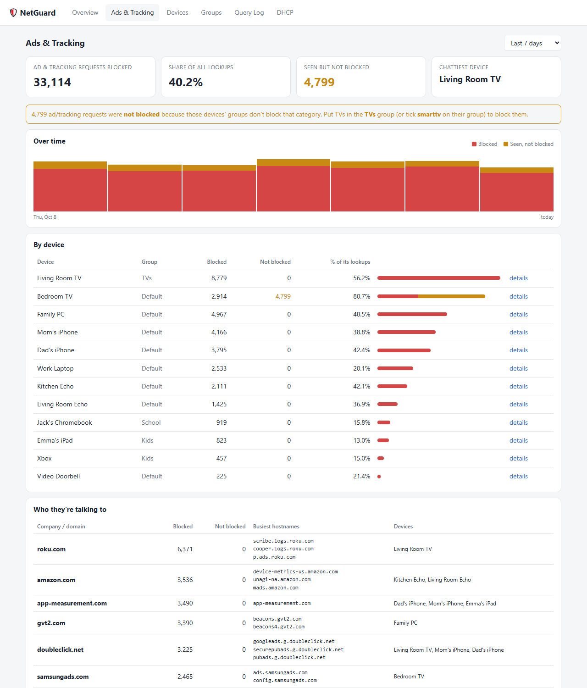
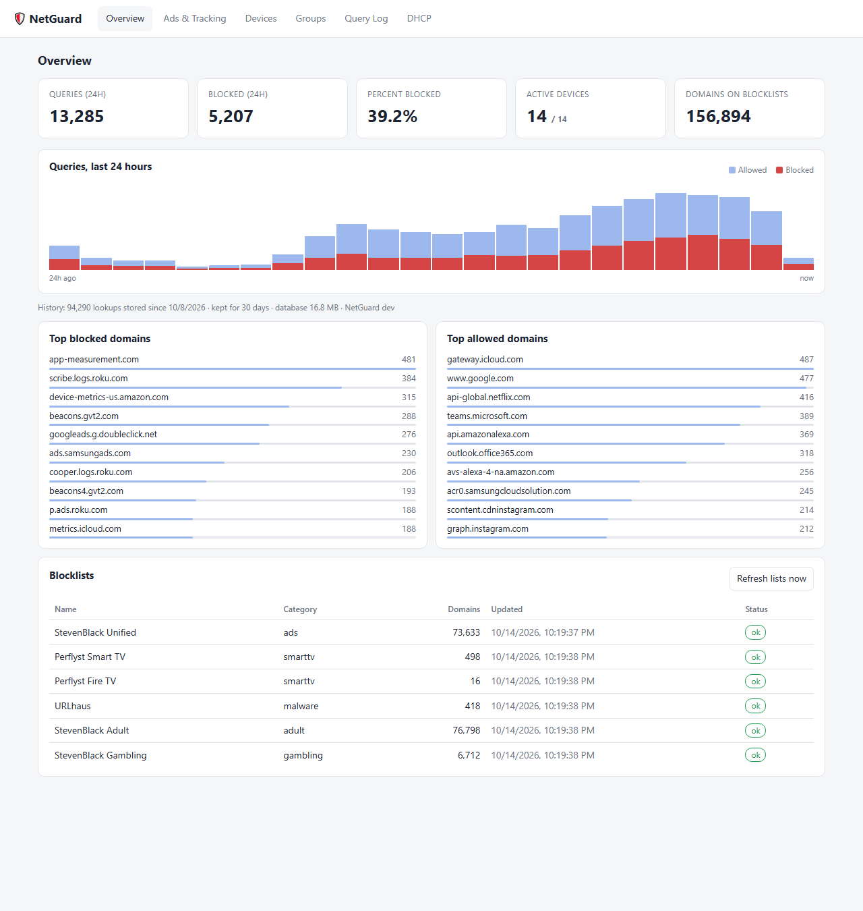
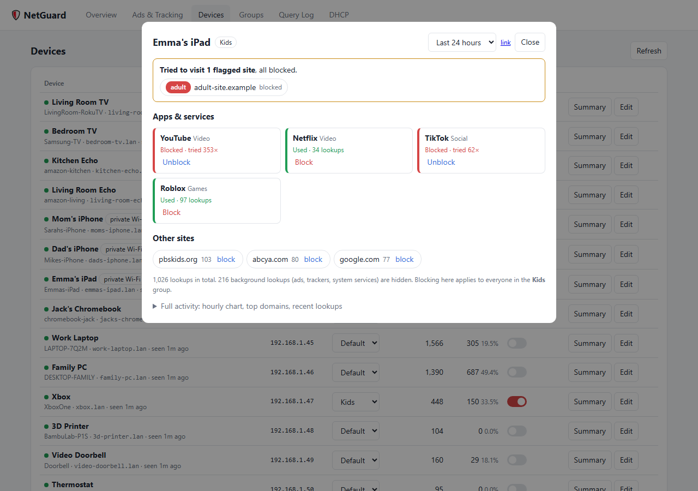
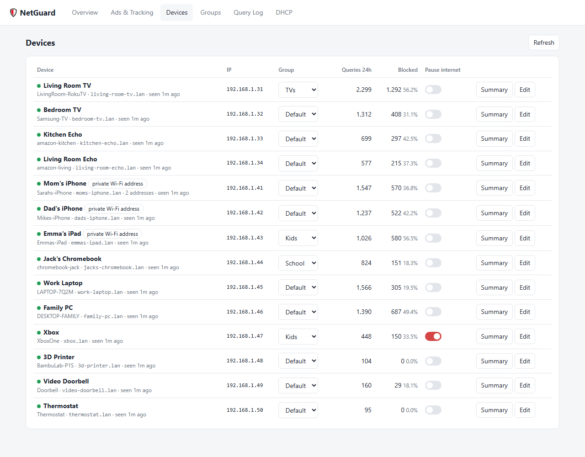
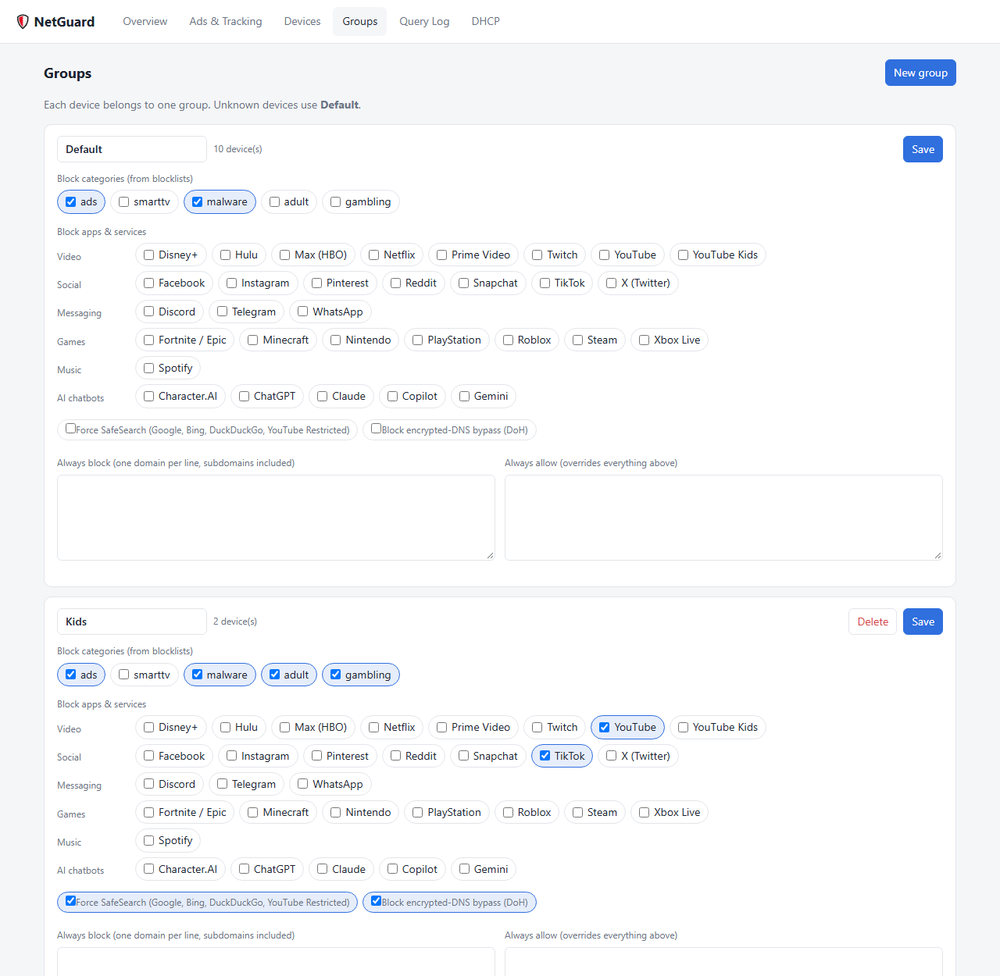
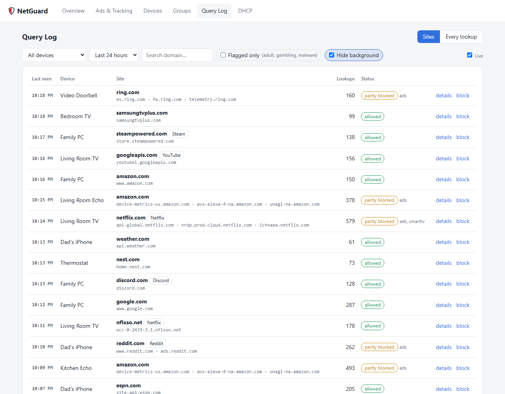

# NetGuard for Raspberry Pi

Network-wide ad blocking (like Pi-hole), smart-TV tracking blocking and per-device parental controls, in a single program that runs on a Raspberry Pi. It comes with a web dashboard showing what every device on your network is talking to.



<table>
  <tr>
    <td><br><b>Overview:</b> every lookup on the network, blocked vs allowed</td>
    <td><br><b>Device summary:</b> apps tried or used, flagged sites, one-click block</td>
  </tr>
  <tr>
    <td><br><b>Devices:</b> groups, pause internet, private Wi-Fi addresses</td>
  <tr>
    <td><br><b>Groups:</b> block categories and apps, force SafeSearch</td>
  </tr>
  <tr>
    <td><br><b>Query log:</b> one line per site, flags adult/gambling/malware</td>
    <td></td>
  </tr>
</table>

<sub>Screenshots use made-up demo data. To regenerate them, run <code>tools/screenshots.ps1</code>.</sub>

> **Provided as-is, with no warranty.** NetGuard becomes part of your home network. If it is set up wrong, devices can lose internet access until you undo the change. The guides below include an undo step for every change.

## The easy way: set it up with Claude

This repository includes a [`CLAUDE.md`](CLAUDE.md) setup guide written for [Claude Code](https://claude.com/claude-code). Claude reads it and walks you through everything, asking about your router, running the commands, and checking each step.

1. **Get the hardware:**
   - a Raspberry Pi 5 *starter kit* (4 GB is plenty), with case, official power supply and a microSD card;
   - an Ethernet cable to connect the Pi to your router. Wi-Fi is not supported for the Pi itself.
2. **Download this project.** Either use **Code → Download ZIP** on GitHub and unzip it, or run `git clone`.
3. **Open the folder in Claude Code** and say:

   > Set up NetGuard on my Raspberry Pi.

Claude will cover:

1. preparing the SD card,
2. connecting to the Pi,
3. giving it a fixed address,
4. writing your settings,
5. installing NetGuard,
6. testing it on one device,
7. switching your whole network over.

Plan for about an hour. You'll need access to your router's admin page.

## What it does

- **Blocks ads, trackers, malware, adult and gambling sites** for every device on the network, using well-known public blocklists organised into categories.
- **Groups with different rules.** Put each device in a group: *Default*, *Kids*, *School*, *TVs*, or your own. A group can:
  - block whole categories;
  - block any of about 30 apps with one click, organised by type:
    - *Video:* YouTube, Netflix, Disney+, Twitch and others;
    - *Social:* TikTok, Instagram, Snapchat and others;
    - *Messaging:* Discord, WhatsApp, Telegram;
    - *Games:* Roblox, Fortnite, Minecraft, Steam, Xbox, PlayStation and others;
    - *Music:* Spotify;
    - *AI chatbots:* ChatGPT, Character.AI, Claude, Gemini, Copilot;
  - force SafeSearch on Google, Bing and DuckDuckGo, and Restricted Mode on YouTube;
  - stop devices bypassing the filter with encrypted DNS or iCloud Private Relay;
  - keep its own always-block and always-allow lists.
- **Dashboards.**
  - *Overview.*
  - *Ads & Tracking:* which devices send the most tracking, and to which companies.
  - *Devices:* click any device for a **summary report card**. It shows which apps it used or tried, any flagged sites, and the other sites it visited, each with a one-click Block. It's a quick check for anything you forgot to block.
  - *Query Log:* one line per site per device, with recognised apps labelled and adult, gambling and malware sites flagged in red. "Hide background" removes ads, trackers and system chatter (iCloud, Windows Update and so on). There's also a view of every individual lookup.

  Flagging works even for sites a group allows: anything on a blocklist is tagged with its category, so you can see that a site was visited, not only when it was blocked.
  - *DHCP leases.*
- **Pause internet** for any single device.
- **Smart-TV telemetry blocking** covers Samsung, LG, Roku, Vizio and Fire TV. Before blocking, you can watch what a TV sends home: it appears as "seen, not blocked".
- **Recognises devices properly.** NetGuard picks up device names from DHCP, Bonjour (mDNS) and Windows networking. It keeps a phone's history and rules when the phone switches to a new *private Wi-Fi address*, and you can merge or split devices by hand.
- **Local names.** Devices can be reached as `name.lan`, and the dashboard as `http://netguard.lan:8080`. Lookups for your private addresses are answered locally and never sent to the internet.
- **Runs on a Pi with no screen.** Updates take one command from your computer, with one-command rollback.

## Choosing a setup

Devices learn which DNS server to use from your network's **DHCP server**, usually your router. NetGuard needs every device to use *it* as their DNS server. There are two ways to do that:

| | **A. Router hands out NetGuard** | **B. NetGuard hands out addresses** |
|---|---|---|
| How | Change your router's **LAN / DHCP** setting "DNS server" to the Pi's address | Turn **off** the router's DHCP server and turn on NetGuard's |
| When | Your router lets you set the DNS server it hands out to devices | It doesn't: many mesh systems, e.g. Netgear Orbi, and many ISP routers |
| Bonus | Simplest; router keeps doing what it does | Better device names, reserved IPs managed in NetGuard |

Avoid changing only the router's **WAN / Internet** DNS setting. Every lookup would then appear to come from the router, and per-device rules and monitoring would stop working.

Router-specific notes are in [`docs/routers/`](docs/routers/). Currently there is one for [Netgear Orbi](docs/routers/netgear-orbi.md); contributions for other routers are welcome.

## Manual setup

If you're not using Claude, the steps are below. `CLAUDE.md` has the same steps in more detail.

1. **SD card.** Use [Raspberry Pi Imager](https://www.raspberrypi.com/software/) to write **Raspberry Pi OS Lite (64-bit)**. In the customisation step:
   - set hostname `netguard`, user `pi` and your time zone;
   - enable **SSH with public-key authentication**, and paste in a public key made for this purpose:

     ```bash
     ssh-keygen -t ed25519 -f ~/.ssh/netguard_ed25519
     ```

     Use a new file name like this one, so you don't overwrite a key you already use elsewhere, such as GitHub.
2. **Connect.** Plug the Pi into the router with Ethernet, power it on, then:

   ```bash
   ssh -i ~/.ssh/netguard_ed25519 pi@netguard.local
   ```

3. **Admin rights without retyping the password**, needed by the deploy script. Run this on the Pi:

   ```bash
   echo 'pi ALL=(ALL) NOPASSWD:ALL' | sudo tee /etc/sudoers.d/010_pi-nopasswd && sudo chmod 440 /etc/sudoers.d/010_pi-nopasswd
   ```

4. **Fixed address.** Pick an address outside your router's DHCP range; shrink the range if needed. Then, on the Pi:

   ```bash
   sudo nmcli con mod "Wired connection 1" ipv4.method manual ipv4.addresses 192.168.1.2/24 ipv4.gateway 192.168.1.1 ipv4.dns "1.1.1.1 9.9.9.9" && sudo nmcli con up "Wired connection 1"
   ```

   Use your network's numbers: your router is usually the gateway, ending in `.1`.
5. **Settings.** On your computer, copy `config.example.yaml` to `config.yaml`. Set `web.password`, and for setup B fill in the `dhcp` section, keeping `enabled: false` for now.
6. **Install.** You need [Go](https://go.dev/dl/) installed on your computer:

   ```powershell
   .\deploy\deploy.ps1 -Target pi@192.168.1.2 -Install
   ```

   On macOS or Linux:

   ```bash
   deploy/deploy.sh pi@192.168.1.2 --install
   ```

7. **Test with one device.** Set its DNS server by hand to the Pi's address and browse for a bit. It should appear on the dashboard at `http://<pi-address>:8080`, with ads blocked.
8. **Switch the network over.**
   - *Setup A:* set the router's LAN/DHCP DNS server to the Pi.
   - *Setup B:*
     1. Turn the router's DHCP **off**.
     2. Set `dhcp.enabled: true`.
     3. Run the deploy with `-PushConfig`, or `--push-config` on macOS/Linux.
     4. Restart the router, so every device reconnects.

   Also turn off the router's **IPv6**, or at least its IPv6 DNS advertisement. Otherwise devices can bypass NetGuard over IPv6.

**Undo:** set the router back the way it was (DHCP on, or DNS back to automatic), and set `dhcp.enabled: false`.

## Updating

Pull the latest code, then:

```powershell
.\deploy\deploy.ps1 -Target pi@192.168.1.2
```

On macOS or Linux, use `deploy/deploy.sh pi@192.168.1.2`. Add `-Rollback`, or `--rollback`, to undo the last update.

What to expect:

- **Downtime:** about 2 seconds. Lookups in that window are retried, and DHCP leases are unaffected.
- **Database upgrades** run automatically and only *add* things, so rolling back still works.
- **Version:** shown at the bottom of the Overview page.

Keep the Pi's own system updated now and then:

```bash
ssh pi@192.168.1.2 "sudo apt update && sudo apt full-upgrade -y && sudo reboot"
```

## Security notes

- **Never expose NetGuard to the internet.** Don't port-forward 53, 67 or 8080 from your router. A DNS server open to the internet gets abused to attack other people, and the dashboard is designed for a home network only: it uses a password over plain HTTP.
- **Set a dashboard password.** Without one, anyone on your Wi-Fi can change the rules, kids included. Your `config.yaml` holds it and is excluded from git.
- **The SSH key** you made for the Pi only works on your home network. It needs no passphrase, but keep your computer's user account protected.

## iPhones, iPads and "private Wi-Fi addresses"

Phones hide their real MAC address behind a *private Wi-Fi address*. On iOS it's under Settings → Wi-Fi → ⓘ next to your network → Private Wi-Fi Address:

- **Off:** the real MAC is used.
- **Fixed:** one private MAC for this network, which never changes. **Recommended for kids' devices.**
- **Rotating:** a new MAC every couple of weeks, which looks like a new device.

If a rotated address reports the same *distinctive* name, e.g. "Emmas-iPhone", NetGuard merges it automatically and the device keeps its rules. Factory names like "iPhone" can't be told apart, so use **Edit → Merge**. Better, give each phone a real name in Settings → General → About → Name. Until a new address is merged it sits in the **Default** group, so keep Default reasonably strict.

To tell identical-looking phones apart, compare the **Wi-Fi Address** shown on each phone (same ⓘ screen) with the Devices page, then use **Edit → Name**.

## History and retention

Every DNS lookup is stored in a SQLite database on the Pi (`/opt/netguard/data/netguard.db`): time, device, domain, and whether it was blocked and why.

- **Retention.** Rows older than `log_retention_days` (default 30) are deleted every hour.
- **Size.** A busy home makes roughly 20–60k lookups a day, which is about 200–300 MB for 30 days.
- **Counts.** Blocked lookups are often retried, especially by TVs, so blocked counts overstate how many ads would really have been shown.

## Incognito / private browsing

Incognito mode doesn't avoid NetGuard: the device still looks up each site through it. NetGuard sees *which sites* are visited, not individual pages or searches, because those are encrypted (HTTPS).

What *can* bypass DNS filtering:

- **iCloud Private Relay.** Blocked by the group option *Block encrypted-DNS bypass*, using Apple's own opt-out for networks.
- **Browser "secure DNS" with a custom provider.** The major providers are blocked by the same option.
- **VPN apps.** These can't be stopped at the DNS level.

## Known limits

- **Traffic volume.** NetGuard sees *which* domains a device looks up, not how much data it uses.
- **Built-in DNS.** Some devices, e.g. some cameras and TVs, ignore the network's DNS and use their own hard-coded server. They show up on the DHCP page but make no lookups through NetGuard.
- **Matching.** Blocklist entries also block their subdomains. If a site breaks, add it to a group's *Always allow* list.

## Roadmap

1. Schedules: bedtime and school-hours rules per group.
2. DNS-over-HTTPS and DNS-over-TLS upstreams.
3. Gateway mode, with the Pi as the router: per-device data usage, and forcing devices with built-in DNS through the filter.
4. Usage time limits, e.g. "2 hours of YouTube a day".

## Running it on a PC (for development)

```bash
go build -o netguard.exe ./cmd/netguard
```

Copy `config.example.yaml` to `config.yaml` and set a password. Leave DHCP off, then run `.\netguard.exe` and open http://localhost:8080. `netguard -scan` lists the devices on your network with their names.

## Layout

```
cmd/netguard        entry point
internal/config     YAML config
internal/store      SQLite (devices, aliases, groups, leases, query log)
internal/filter     blocklists, services, SafeSearch, per-device decisions, device identity/merging
internal/dnsserver  filtering + caching DNS forwarder, local names
internal/dhcpserver DHCPv4 server
internal/clients    IP -> MAC (leases, ARP/NDP neighbour table)
internal/names      device name discovery (mDNS, NetBIOS), name helpers
internal/querylog   batched query log writer
internal/web        JSON API + embedded dashboard
deploy/             deploy.ps1 / deploy.sh (your computer), install.sh + systemd unit (the Pi)
docs/routers/       router-specific setup notes
```

## License

[MIT](LICENSE): free to use, change and share, with no warranty. Blocklists are downloaded from their publishers at runtime and remain under their own licenses.
